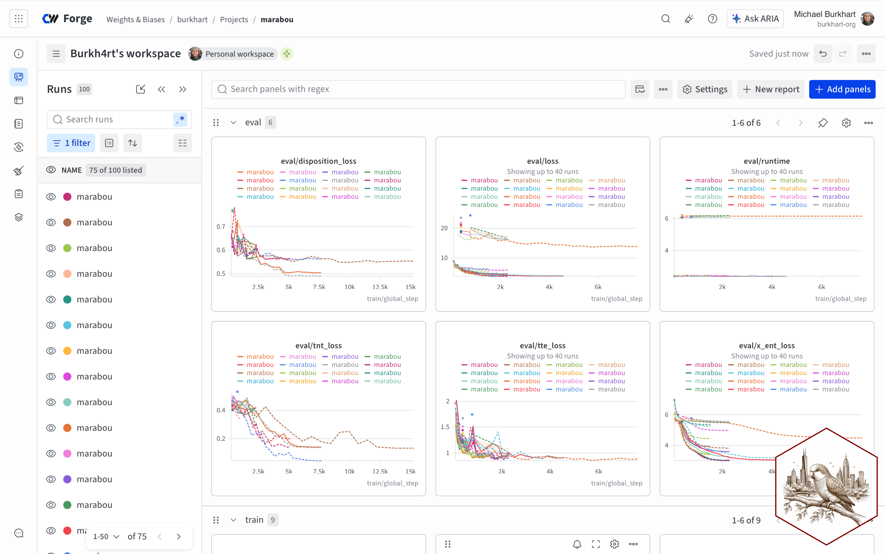

# Summary

A recent trend in predictive medicine involves converting electronic health
records (EHRs) into descriptive sequences of tokens and then training generative
models on these sequences using a self-supervised objective [@Guo26b]. The
sequences capture a wide variety of important events during a patient's stay,
such as vitals measurements, lab tests, medicine administration, intrahospital
transfers, continuous kidney replacement therapy [@Tei25], respiratory support
[@Hoh25], changes in code status [@Ste17], proning [@Gue20], estimated sequential
organ failure assessment (SOFA) scores related to sepsis [@Sin16], _inter alia_.

Given a trained model, inference for downstream events on partially completed
novel sequences typically proceeds in one of the following ways (see Figure
\ref{fig:inference} for a schematic):

1. _Representation-based inference_, or rep-based inference, extracts
   model-derived representations from each variable-length sequence up to the
   point in time that inference is to be performed. These fixed-length vectors
   then serve as features to train outcome-specific supervised models, which
   themselves take the form of off-the-shelf classifiers such a logistic
   regression or gradient boosted decision trees that can be learned with a
   fraction of the compute required to train the original model. See @Wor23,
   @Guo24, @Wor25, @Lee26, @Guo26, and @Zha26 for notable examples.

2. _Generative inference_, or zero-shot inference, applies the generative
   capabilities of the trained model directly to a novel sequence to sample
   potential completions of the sequence. These generated sequences are then used
   to form a Monte Carlo-style estimate of the probability for a token-related
   outcome of interest. @McD23, @Kra24, @Ren24, @Ren25, @Wax25, and @Sol26
   provide notable examples.

3. _Supervised finetuning_ modifies the training objective to prioritize specific
   downstream outcomes of interest. Oftentimes, a model's architecture will be
   slightly modified to incorporate a time-to-event or classifier head. During
   inference, these heads can be used to directly predict outcome(s) of interest.
   In some cases, the models may be ``pretrained'' with the supervised objective
   prior to additional epoch(s) of specialized training. See @Ste24, @Fal25,
   @Bur25, and @Cha26 for examples.

Cotorra supports all three types of inference, along with training and
hyperparameter tuning, and does so via a CLI interface with a fair amount of
configurability. The library began with code originally developed in 2025
[@Bur25; @Bur26] and has been continuously extended to support work in generative
inference [@Sol26], tokenization best practices [@Lee26], and federated learning
[@Bur26b].

# Statement of need

Generative event models, or foundation model on tokenized event sequences, have
generated a great deal of excitement in the research community for their
promising performance and resilience to distribution shift. They consider a
wholistic account of a patient's hospitalization and could be used to overcome
some of the challenges associated with fragmented model deployment [@Ram26].
However, they have yet to be widely adopted or deployed in real-world scenarios
[@Wor23b]. In a recent literature review, @Guo26 admit that none of the
fifty-three studies considered described a clinical deployment. These models
require a fair amount of data preprocessing and training to achieve their
promised benefits. Configurable, open source tools to prepare data and train
these models should help to improve adoption and empower healthcare
professionals.

# State of the field

As research products of an actively developing field, much of the currently
available code is designed to reproduce the results of a specific paper. Some
repositories and tools have received sustained development and are worth
consideration from a potential practitioner. The MEDS ecosystem [@McD26] offers
tools both for converting data into the MEDS format and for training models. The
Vector Institute's [odyssey](https://github.com/VectorInstitute/odyssey) library
grew out of EHRMamba [@Fal25]; it takes MEDS event streams as input. The Shah
lab's [femr](https://github.com/som-shahlab/femr) library grew out of work on the
MOTOR [@Ste24] paper. However, at the time of writing, the most recent commit to
the default / main branch occurred over a year ago.

# Software design

We aimed to create configurable and reuseable code that can readily be adapted to
new datasets and formats. Methods for data collation and tokenization that do not
depend on pytorch were placed into a separate library,
[`cocoa`](https://pypi.org/project/cocoa-tokenizer/), on which `cotorra` depends.
Each of the library's main commands---`train`, `tune`, `extract`,
`rep-based-score`, and `generative-score`---are configurable via yaml files to
allow for substantial customization without requiring a working knowledge of
python. Configuration overrides can also be passed as command line arguments, to
prevent the need to maintain multiple similar configurations.

## Training / tuning

The `train` command supports any model architecture compatible with Hugging
Face's `transformers` library [@Wol20], and offers configurable:

- customized loss functions (including a inspired quantile token loss _a la_
  @Zau25),
- time-to-event, time-to-next-token, and classification-style heads,
- time-based RoPE [@Wei26],
- best-fit sequence packing [@Din24],

and can report training metrics to the platform formerly known as weights and
biases, as seen in Figure \ref{fig:scrnsht}.

The `tune` command runs a configurable number of training runs with `optuna`
[@Aki19], over a user-determined set of hyperparameters.

## Rep-based inference

Sequence representations up to a pre-configured point in time can be collected
with the `extract` command. The `rep-based-score` then learns a supervised
classifier on training and tuning datasets and applies it to the held-out data.
Currently supported classifiers include logistic regression (with optional
regularization selected via cross-validation), XGBoost, LightGBM, and k-NN.

## Generative inference

The `generative-inference` command wraps L. Solo's
[`quick-sco-re`](https://github.com/lukesolo-ml/SCOPE_REACH_optimized_inference.git)
library.

## Inference via supervised finetuning

Supervised finetuning can be performed by configuring `tte_objective` (for
time-to-event modeling) or `disposition_objective` (for sequence-level
classification) prior to training, and then running the `extract` command on
held-out sequences of interest.

# Research impact statement

This library started with code developed for projects on evaluating
representation dynamics and transferability [@Bur25] and quantifying information
at the token and event levels [@Bur26], and subsequently supported work in
generative inference [@Sol26], establishing best practices for tokenization
[@Lee26], and federated learning [@Bur26b].

# AI usage disclosure

Claude Code, OpenAI Codex, and Github Copilot were used to develop and document
this library. An emphasis on modularity, frequent commits, and testing was
adopted specifically to allow these tools to perform their best. Humans reviewed,
modified, and validated all AI-generated content. Architectural and design
decisions were made by humans. This document in particular was entirely typed by
hand.

# Acknowledgements

Compute resources used to develop and test this library were provided in part by
the Center for Research Informatics (CRI) at the University of Chicago and funded
by the Biological Sciences Division and the Institute for Translational
Medicine/CTSA (NIH UL1TR002389).

# References
